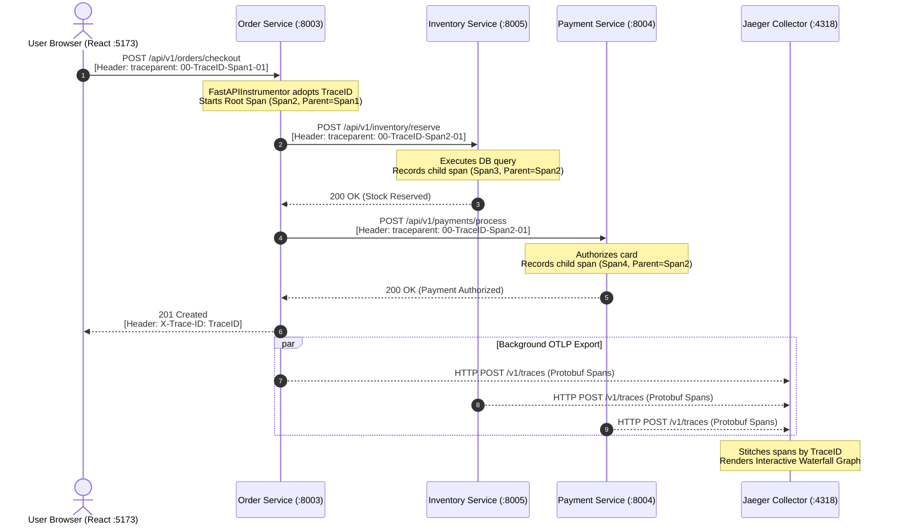

# The Ultimate Guide to OpenTelemetry: From Origin to Code & Jaeger Export

> **Author**: Manoj Kumar  
> **Topic**: OpenTelemetry (OTel) Deep-Dive — Origins, Mechanics, Context Propagation, Client-to-Backend Lifecycle, Complete Installation, and Production Code.

---

## Table of Contents
1. [Where Did OpenTelemetry Start? (Historical Origins)](#1-where-did-opentelemetry-start-historical-origins)
2. [What is OpenTelemetry & How Does It Work Under the Hood?](#2-what-is-opentelemetry--how-does-it-work-under-the-hood)
3. [The Core Mechanics: Spans, Traces, and the W3C Standard](#3-the-core-mechanics-spans-traces-and-the-w3c-standard)
4. [End-to-End Data Journey: From Frontend Click to Jaeger UI](#4-end-to-end-data-journey-from-frontend-click-to-jaeger-ui)
5. [Complete Step-by-Step Installation Guide](#5-complete-step-by-step-installation-guide)
   - [Step 1: Setting up Jaeger Collector & Storage](#step-1-setting-up-jaeger-collector--storage)
   - [Step 2: Frontend Implementation (React / Axios / W3C Header Injection)](#step-2-frontend-implementation-react--axios--w3c-header-injection)
   - [Step 3: Backend Implementation (FastAPI / SQLAlchemy / HTTPX)](#step-3-backend-implementation-fastapi--sqlalchemy--httpx)
6. [How Data is Sent to Jaeger (The Exporter Deep-Dive)](#6-how-data-is-sent-to-jaeger-the-exporter-deep-dive)
7. [Manual Spans, Custom Attributes & Error Recording](#7-manual-spans-custom-attributes--error-recording)
8. [Verifying Traces in Jaeger UI](#8-verifying-traces-in-jaeger-ui)
9. [Production Best Practices & Pitfalls to Avoid](#9-production-best-practices--pitfalls-to-avoid)

---

## 1. Where Did OpenTelemetry Start? (Historical Origins)

To truly understand OpenTelemetry, you have to understand the evolutionary problem it solved.

```
       2010                     2015                    2018                   2019 → Present
┌─────────────────┐      ┌─────────────────┐     ┌─────────────────┐      ┌───────────────────────┐
│  Google Dapper  │ ───► │   OpenTracing   │ ──┐ │   OpenCensus    │ ───► │    OpenTelemetry      │
│ Research Paper  │      │  (Tracing Only) │   │ │ (Traces+Metrics)│      │  (Traces+Metrics+Logs)│
└─────────────────┘      └─────────────────┘   │ └─────────────────┘      └───────────────────────┘
                                               └──────────┬──────────────┘
                                                  CNCF Merger (May 2019)
```

### 1. The Dapper Paper (2010)
In 2010, Google published a seminal research paper titled:  
*"Dapper, a Large-Scale Distributed Systems Tracing Infrastructure"*.  
Google showed how thousands of internal services handled search queries by attaching a correlation identifier (`TraceID`) to RPC metadata and recording start/end timestamps (`Spans`). Every modern tracing system (Jaeger, Zipkin, AWS X-Ray, Datadog) is based on Dapper's design.

### 2. The Fragmentation Era (2015 – 2018)
As companies adopted microservices, two competing open-source projects emerged:
1. **OpenTracing (2015)**: Hosted by the CNCF. Provided a universal *API* for distributed tracing, but had no default implementation and lacked metrics.
2. **OpenCensus (2018)**: Open-sourced by Google. Provided *both* an API and a working SDK implementation for tracing and metrics, but competed directly with OpenTracing.

This split the software world: library authors didn't know which standard to instrument for, and companies faced vendor lock-in.

### 3. The Merger: OpenTelemetry (May 2019)
In May 2019, the Cloud Native Computing Foundation (CNCF) announced that OpenTracing and OpenCensus would merge into a single project: **OpenTelemetry (abbreviated as OTel)**.

Today, **OpenTelemetry is the second most active CNCF project in the world, surpassed only by Kubernetes**. It provides:
- **One universal API and SDK** across Python, JavaScript, Java, Go, C#, Rust, and Ruby.
- **Vendor neutrality**: Collect telemetry once; send it to Jaeger, Prometheus, Grafana Tempo, Datadog, or AWS X-Ray simply by changing an endpoint URL.

---

## 2. What is OpenTelemetry & How Does It Work Under the Hood?

OpenTelemetry is **NOT** a storage database and **NOT** a web dashboard.  
OpenTelemetry is the **engine that sits inside your code** to generate, correlate, buffer, and export telemetry data.

### The 4 Architecture Layers of OTel

```
┌─────────────────────────────────────────────────────────────┐
│ 1. INSTRUMENTATIONS (FastAPI, HTTPX, SQLAlchemy, Axios)     │
│    Intercepts requests & queries automatically              │
├─────────────────────────────────────────────────────────────┤
│ 2. OPENTELEMETRY API                                        │
│    Abstract interfaces: Tracer, Span, Context               │
├─────────────────────────────────────────────────────────────┤
│ 3. OPENTELEMETRY SDK (The Engine)                           │
│    • Resource: Identifies service name, version, host       │
│    • Sampler: Decides whether to record trace (100%, 5%)    │
│    • BatchSpanProcessor: Queues spans in background memory  │
├─────────────────────────────────────────────────────────────┤
│ 4. OTLP EXPORTER (Transmitter)                              │
│    Encodes spans into Protobuf and sends to Jaeger via HTTP │
└─────────────────────────────────────────────────────────────┘
```

1. **Instrumentation Layer**: Intercepts inbound and outbound network calls (HTTP requests, database calls, message queues).
2. **OTel API**: Provides the syntax to create spans (`tracer.start_as_current_span(...)`). It is decoupled from the SDK so open-source libraries can use it without pulling heavy dependencies.
3. **OTel SDK**: The execution engine configured at application startup. It manages:
   - **`Resource`**: Metadata identifying the microservice (e.g. `service.name: "order-service"`).
   - **`Sampler`**: Determines whether to trace a request (e.g., 100% in development, 5% in high-traffic production).
   - **`SpanProcessor`**: Buffers finished spans in an in-memory queue.
4. **OTLP Exporter**: Formats the buffered spans into standard **OpenTelemetry Protocol (OTLP)** protobuf packets and transmits them over HTTP (`:4318`) or gRPC (`:4317`) to Jaeger.

---

## 3. The Core Mechanics: Spans, Traces, and the W3C Standard

### What is a Span?
A **Span** is the fundamental atomic building block of a trace. It represents a single contiguous unit of execution:
- An incoming HTTP request (`POST /api/v1/orders/checkout`)
- A database query (`SELECT * FROM inventory WHERE sku = 'MACBOOK-M3'`)
- An outgoing inter-service call (`POST http://localhost:8004/api/v1/payments/process`)

#### Fields Inside Every Span:
```json
{
  "trace_id": "4bf92f3577b34da6a3ce929d0e0e4736",
  "span_id": "00f067aa0ba902b7",
  "parent_span_id": "5fb397be34d23b0f",
  "name": "inventory.reserve_stock",
  "start_time": "2026-10-17T10:56:30.100Z",
  "end_time": "2026-10-17T10:56:30.142Z",
  "attributes": {
    "sku": "MACBOOK-M3-MAX",
    "quantity": 2,
    "warehouse": "SAN-FRANCISCO-HUB"
  },
  "status": { "code": "OK" }
}
```

### What is a Trace?
A **Trace** is a collection of spans that share the exact same `trace_id`, organized as a **Directed Acyclic Graph (DAG)** via `parent_span_id` pointers.

---

### The Universal Glue: W3C `traceparent` Header

When a request travels from the browser to Service A, and Service A calls Service B, how do they stay linked in the same trace?  
They pass the universal **W3C Trace Context** HTTP header:

```
traceparent: 00-4bf92f3577b34da6a3ce929d0e0e4736-00f067aa0ba902b7-01
```

```
┌──────┬──────────────────────────────────┬──────────────────┬──────┐
│  00  │ 4bf92f3577b34da6a3ce929d0e0e4736 │ 00f067aa0ba902b7 │  01  │
└──────┴──────────────────────────────────┴──────────────────┴──────┘
   │                      │                        │            │
Version            Trace ID (128-bit)       Span ID (64-bit)  Flags
 (Fixed)             (32 Hex Chars)          (16 Hex Chars)   (01 = Sampled)
```

1. **`00` (Version)**: Current W3C specification version.
2. **`4bf92f...` (Trace ID)**: A 128-bit globally unique number. **Generated ONCE at the origin (Frontend)** and never changes across the entire distributed journey.
3. **`00f067...` (Span ID)**: A 64-bit unique number representing the immediate caller's span.
4. **`01` (Trace Flags)**: `01` means "Sampled" (the backend must record and export this trace).

---

## 4. End-to-End Data Journey: From Frontend Click to Jaeger UI

Here is the exact lifecycle of a user transaction in our e-commerce microservices system:



### The 6 Execution Steps Explained:

1. **Trace Birth (Frontend)**:
   - When the user clicks **"Place Order"**, the Axios request interceptor calls `generateTraceId()` (32 hex characters) and `generateSpanId()` (16 hex characters).
   - It attaches the header: `traceparent: 00-{TraceID}-{Span1}-01`.

2. **Backend Extraction (`order-service :8003`)**:
   - `FastAPIInstrumentor` receives the request. It extracts `traceparent` from headers.
   - It does **not** create a new Trace ID; it **adopts the frontend's Trace ID**.
   - It creates a new server span (`Span2`) with `parent_id = Span1`.
   - It stores `Span2` in Python's task-local `contextvars`.

3. **Downstream Propagation (`inventory-service :8005`)**:
   - `order-service` calls `inventory-service` using `httpx.AsyncClient`.
   - `HTTPXClientInstrumentor` intercepts the outgoing call and automatically injects a new `traceparent`: `00-{TraceID}-{Span2}-01`.
   - `inventory-service` reads this header, creates `Span3` (child of `Span2`), runs the database query, and records the SQL duration.

4. **Payment & Notification Propagation (`:8004` & `:8006`)**:
   - The same Trace ID travels to `payment-service` and `notification-service`.

5. **Asynchronous Buffer & Flush**:
   - When each span finishes (`span.end()`), it is pushed into an in-memory queue (`BatchSpanProcessor`).
   - Every 500ms, a background worker batches these spans, serializes them to Protobuf, and sends an HTTP POST request to `http://localhost:4318/v1/traces`.

6. **Jaeger Ingestion & Waterfall Rendering**:
   - The Jaeger OTLP receiver accepts the spans from all 6 microservices.
   - Because they all share the exact same `trace_id`, Jaeger joins them together.
   - It uses `parent_span_id` to build the recursive parent-child tree.
   - When you open `http://localhost:16686/trace/{trace_id}`, you see every single microservice, database query, and network latency bar lined up in a single waterfall.

---

## 5. Complete Step-by-Step Installation Guide

### Step 1: Setting up Jaeger Collector & Storage

Jaeger is packaged as an all-in-one Docker image containing the OTLP Collector, Query Engine, and Web UI.

#### Run with Docker CLI:
```bash
docker run -d --name jaeger \
  -e COLLECTOR_OTLP_ENABLED=true \
  -p 16686:16686 \
  -p 4317:4317 \
  -p 4318:4318 \
  jaegertracing/all-in-one:latest
```

#### Run with Docker Compose (`docker-compose.yml`):
```yaml
version: '3.8'

services:
  jaeger:
    image: jaegertracing/all-in-one:latest
    container_name: jaeger
    environment:
      - COLLECTOR_OTLP_ENABLED=true
    ports:
      - "16686:16686" # Web UI: http://localhost:16686
      - "4317:4317"   # OTLP gRPC Receiver
      - "4318:4318"   # OTLP HTTP Receiver (/v1/traces)
    restart: unless-stopped
```

---

### Step 2: Frontend Implementation (React / Axios / W3C Header Injection)

In the frontend, we must generate standard W3C headers and inject them into Axios requests.

#### File 1: `frontend/src/services/telemetry.js`
```javascript
/**
 * Generates RFC-compliant W3C Trace Context (00-{trace_id}-{span_id}-01)
 */

// Generate 128-bit lowercase hex string (32 characters)
export function generateTraceId() {
  const chars = '0123456789abcdef';
  let traceId = '';
  for (let i = 0; i < 32; i++) {
    traceId += chars[Math.floor(Math.random() * 16)];
  }
  return traceId;
}

// Generate 64-bit lowercase hex string (16 characters)
export function generateSpanId() {
  const chars = '0123456789abcdef';
  let spanId = '';
  for (let i = 0; i < 16; i++) {
    spanId += chars[Math.floor(Math.random() * 16)];
  }
  return spanId;
}

// Creates the complete W3C traceparent header object
export function createW3CTraceparent(traceId = generateTraceId(), spanId = generateSpanId()) {
  return {
    traceId,
    spanId,
    traceparent: `00-${traceId}-${spanId}-01`, // 01 flag = sampled
  };
}

// Helper to generate direct link to Jaeger Web UI
export function getJaegerTraceUrl(traceId) {
  if (!traceId) return 'http://localhost:16686/search';
  return `http://localhost:16686/trace/${traceId}`;
}
```

#### File 2: `frontend/src/services/api.js` (Axios Interceptors)
```javascript
import axios from 'axios';
import { createW3CTraceparent } from './telemetry';

const apiClient = axios.create({
  baseURL: 'http://localhost:8003', // e.g. order-service
  timeout: 8000,
});

// REQUEST INTERCEPTOR: Injects W3C traceparent before request leaves browser
apiClient.interceptors.request.use((config) => {
  const { traceId, spanId, traceparent } = createW3CTraceparent();

  // Attach standard W3C header
  config.headers['traceparent'] = traceparent;
  config.headers['X-Request-ID'] = `req-${Date.now()}`;

  // Store metadata to calculate round-trip duration in response interceptor
  config.metadata = {
    startTime: performance.now(),
    traceId,
    spanId,
  };

  return config;
});

// RESPONSE INTERCEPTOR: Captures latency and backend Trace ID
apiClient.interceptors.response.use(
  (response) => {
    const durationMs = Math.round(performance.now() - response.config.metadata.startTime);
    // Backend returns its active Trace ID in X-Trace-ID header
    const backendTraceId = response.headers['x-trace-id'] || response.config.metadata.traceId;

    console.log(`[Trace: ${backendTraceId}] Success in ${durationMs}ms`);
    return response;
  },
  (error) => {
    const durationMs = Math.round(performance.now() - error.config?.metadata?.startTime);
    const backendTraceId = error.response?.headers?.['x-trace-id'] || error.config?.metadata?.traceId;

    console.error(`[Trace: ${backendTraceId}] Failed in ${durationMs}ms:`, error.message);
    return Promise.reject(error);
  }
);

export default apiClient;
```

---

### Step 3: Backend Implementation (FastAPI / SQLAlchemy / HTTPX)

#### 1. Install Required Python Packages
```bash
pip install \
  opentelemetry-api \
  opentelemetry-sdk \
  opentelemetry-exporter-otlp-proto-http \
  opentelemetry-instrumentation-fastapi \
  opentelemetry-instrumentation-httpx \
  opentelemetry-instrumentation-sqlalchemy \
  opentelemetry-instrumentation-logging
```

#### 2. Telemetry Configuration Module (`app/core/telemetry.py`)
```python
import logging
from opentelemetry import trace
from opentelemetry.exporter.otlp.proto.http.trace_exporter import OTLPSpanExporter
from opentelemetry.instrumentation.fastapi import FastAPIInstrumentor
from opentelemetry.instrumentation.httpx import HTTPXClientInstrumentor
from opentelemetry.instrumentation.logging import LoggingInstrumentor
from opentelemetry.sdk.resources import Resource
from opentelemetry.sdk.trace import TracerProvider
from opentelemetry.sdk.trace.export import BatchSpanProcessor
from opentelemetry.sdk.trace.sampling import TraceIdRatioBased

logger = logging.getLogger(__name__)
_tracer_provider: TracerProvider = None

def setup_telemetry(app, service_name: str, otlp_endpoint: str = "http://localhost:4318/v1/traces"):
    """
    Initializes OpenTelemetry TracerProvider, BatchSpanProcessor,
    and automatic instrumentations for FastAPI, HTTPX, and Logging.
    """
    global _tracer_provider

    # 1. Define Resource attributes (Service Identity in Jaeger)
    resource = Resource.create({
        "service.name": service_name,
        "service.version": "1.0.0",
        "deployment.environment": "development",
    })

    # 2. Configure Sampler (1.0 = 100% of traces captured)
    sampler = TraceIdRatioBased(1.0)

    # 3. Initialize SDK TracerProvider
    _tracer_provider = TracerProvider(resource=resource, sampler=sampler)

    # 4. Configure Asynchronous OTLP HTTP Span Exporter
    otlp_exporter = OTLPSpanExporter(
        endpoint=otlp_endpoint,
        timeout=5.0,  # 5-second network timeout
    )

    # 5. Attach BatchSpanProcessor (Queues spans in memory; flushes in background)
    span_processor = BatchSpanProcessor(
        otlp_exporter,
        max_queue_size=2048,
        schedule_delay_millis=500,  # Flush every 500ms
        max_export_batch_size=512,
    )
    _tracer_provider.add_span_processor(span_processor)

    # 6. Register as Global TracerProvider
    trace.set_tracer_provider(_tracer_provider)

    # 7. Auto-instrument FastAPI incoming endpoints
    FastAPIInstrumentor.instrument_app(
        app,
        tracer_provider=_tracer_provider,
        excluded_urls="health,docs,openapi.json,redoc",
    )

    # 8. Auto-instrument HTTPX outgoing client calls (injects W3C headers automatically)
    HTTPXClientInstrumentor().instrument()

    # 9. Correlate standard Python logs with active trace_id and span_id
    LoggingInstrumentor().instrument(set_logging_format=False)

    logger.info("OpenTelemetry successfully initialized for service: %s", service_name)

def shutdown_telemetry():
    """Flushes remaining spans from memory before server shuts down."""
    global _tracer_provider
    if _tracer_provider:
        _tracer_provider.shutdown()
        logger.info("OpenTelemetry TracerProvider shutdown complete.")

def get_tracer(name: str):
    """Returns a Tracer instance to create custom business spans."""
    return trace.get_tracer(name)
```

#### 3. Application Lifecycle & CORS Setup (`app/main.py`)
```python
import time
import uuid
from contextlib import asynccontextmanager
from fastapi import FastAPI, Request
from fastapi.middleware.cors import CORSMiddleware
from opentelemetry import trace
from app.core.telemetry import setup_telemetry, shutdown_telemetry

def get_current_trace_ids():
    """Extracts active trace_id and span_id as 32-hex and 16-hex strings."""
    span = trace.get_current_span()
    span_ctx = span.get_span_context() if span else None
    if span_ctx and span_ctx.is_valid:
        return f"{span_ctx.trace_id:032x}", f"{span_ctx.span_id:016x}"
    return None, None

@asynccontextmanager
async def lifespan(app: FastAPI):
    # Initialize OpenTelemetry on startup
    setup_telemetry(app=app, service_name="order-service")
    yield
    # Flush pending spans on shutdown
    shutdown_telemetry()

app = FastAPI(title="Order Service", lifespan=lifespan)

# CRITICAL FOR BROWSER ACCESS: Expose headers so JavaScript can read Trace IDs
app.add_middleware(
    CORSMiddleware,
    allow_origins=["*"],
    allow_credentials=True,
    allow_methods=["*"],
    allow_headers=["*"],
    expose_headers=["*"], # Allows reading X-Trace-ID in browser
)

# Correlation Middleware: Appends Trace ID to HTTP Response Headers
@app.middleware("http")
async def correlation_middleware(request: Request, call_next):
    start_time = time.perf_counter()
    response = await call_next(request)
    duration_ms = (time.perf_counter() - start_time) * 1000

    trace_id, span_id = get_current_trace_ids()
    if trace_id:
        response.headers["X-Trace-ID"] = trace_id
    if span_id:
        response.headers["X-Span-ID"] = span_id
    response.headers["X-Process-Time-Ms"] = f"{duration_ms:.2f}"

    return response
```

---

## 6. How Data is Sent to Jaeger (The Exporter Deep-Dive)

Why does tracing not slow down our FastAPI endpoints?  
Because **exporting happens asynchronously in the background via `BatchSpanProcessor`**.

### The Batching Lifecycle:
```
[HTTP Request Ends]
        │
        ▼ span.end()
┌────────────────────────────────────────┐
│ In-Memory Ring Buffer (max 2048 spans) │
└───────────────────┬────────────────────┘
                    │
                    ▼ Background Thread Triggers (every 500ms or 512 spans)
┌────────────────────────────────────────┐
│ Serialize Spans to OTLP Protobuf       │
└───────────────────┬────────────────────┘
                    │
                    ▼ HTTP POST http://localhost:4318/v1/traces
┌────────────────────────────────────────┐
│ Jaeger Collector Ingestion Queue       │
└────────────────────────────────────────┘
```

1. When your route function finishes, `span.end()` records the timestamp and pushes the span into an in-memory queue. This takes **less than 5 microseconds**.
2. A background worker thread wakes up every 500 milliseconds (or when 512 spans accumulate).
3. It packages the spans into a compressed **OTLP binary Protobuf payload**.
4. It sends an HTTP POST request to Jaeger (`/v1/traces`).
5. **Fault Tolerance Guarantee**: If Jaeger crashes or network blips occur, the queue silently drops old spans when full (`max_queue_size=2048`). **It never throws an exception into your customer's HTTP response**.

---

## 7. Manual Spans, Custom Attributes & Error Recording

Automatic instrumentation tracks HTTP endpoints, but what about your core business logic?  
You can create **custom manual spans**:

```python
from app.core.telemetry import get_tracer
from opentelemetry.trace import Status, StatusCode

tracer = get_tracer("order_checkout_workflow")

async def process_checkout(order_data):
    # Create a custom nested span under the current HTTP request span
    with tracer.start_as_current_span("business.validate_and_reserve") as span:
        # 1. Attach business attributes (Searchable in Jaeger UI!)
        span.set_attribute("customer.email", order_data.customer_email)
        span.set_attribute("order.total_amount", float(order_data.total_amount))
        span.set_attribute("payment.method", order_data.payment_method)

        try:
            # Execute business logic
            await reserve_inventory(order_data.items)
            await charge_payment(order_data)
            
            span.set_status(Status(StatusCode.OK))
            return {"status": "SUCCESS"}

        except Exception as exc:
            # 2. Record the exception (renders RED in Jaeger with full stack trace)
            span.record_exception(exc)
            span.set_status(Status(StatusCode.ERROR, description=str(exc)))
            span.set_attribute("error.type", exc.__class__.__name__)
            
            # Execute saga compensation rollback
            await release_inventory(order_data.items)
            raise exc
```

In Jaeger UI, any span with `StatusCode.ERROR` turns **RED**, and the **"Events"** tab displays the full Python exception stack trace.

---

## 8. Verifying Traces in Jaeger UI

### 1. Launch Everything
```bash
# 1. Start all 6 microservices
./start_all.sh

# 2. Start React Frontend
cd frontend && npm run dev
```

### 2. Generate a Request
- Open `http://localhost:5173`.
- Click **"Demo OTP Login"** and verify.
- Add an item to your cart and click **"Place & Confirm Order"**.

### 3. Open Jaeger Search
- Go to: **`http://localhost:16686/search`**
- Under **Service**, pick `order-service`.
- Click **"Find Traces"**.
- Click on the latest trace to open the waterfall view:

```
order-service: POST /api/v1/orders/checkout ────────────────────── [185ms]
  ├── order-service: business.validate_and_reserve ──────────────── [170ms]
  │     ├── inventory-service: POST /api/v1/inventory/reserve ──── [42ms]
  │     │     └── inventory-service: db.execute UPDATE ─────────── [12ms]
  │     ├── payment-service: POST /api/v1/payments/process ─────── [65ms]
  │     │     └── payment-service: authorize_card ──────────────── [58ms]
  │     └── notification-service: POST /api/v1/notifications/send─ [28ms]
```

---

## 9. Production Best Practices & Pitfalls to Avoid

| Practice | Bad Pattern (Anti-Pattern) | Recommended Production Pattern |
|---|---|---|
| **Sampling** | Sampling 100% of traces at 50,000 RPS (will crash storage). | Use `TraceIdRatioBased(0.05)` (5% sample) in high-throughput production. |
| **Span Processor** | Using `SimpleSpanProcessor` (blocks every HTTP request synchronously). | Always use `BatchSpanProcessor` with background thread flushing. |
| **Sensitive Data** | Putting raw credit card numbers or passwords in span attributes. | Redact PII: only log tokens, hashed user IDs, or masked references. |
| **CORS Headers** | Forgetting `expose_headers=["*"]` on backend FastAPI. | Explicitly expose `X-Trace-ID`, `X-Span-ID`, `X-Request-ID`. |
| **Exporter Failure** | Letting exporter connection errors raise unhandled exceptions. | Use `BatchSpanProcessor` with timeouts so failures are non-blocking. |
| **Trace Context** | Making outgoing HTTP calls using bare `urllib` or raw sockets. | Always use instrumented HTTP clients (`httpx.AsyncClient` or `requests`). |

---

## Summary Checklist
- [x] **Jaeger running** on port `16686` (UI) and `4318` (OTLP HTTP).
- [x] **Frontend injecting** W3C `traceparent: 00-{trace_id}-{span_id}-01` on every Axios call.
- [x] **FastAPI extracting** context automatically via `FastAPIInstrumentor`.
- [x] **FastAPI propagating** context downstream via `HTTPXClientInstrumentor`.
- [x] **Database operations traced** via `SQLAlchemyInstrumentor`.
- [x] **Backend exposing** `X-Trace-ID` in response headers for instant one-click Jaeger links.

